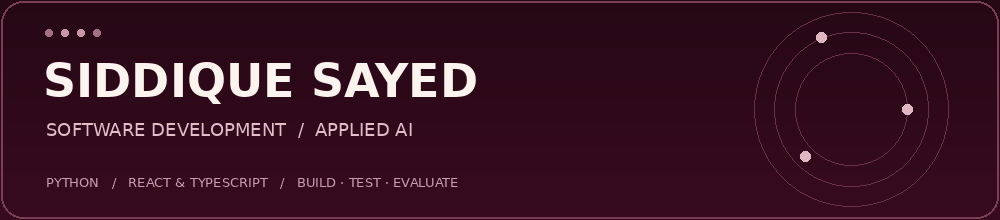

  

  <a href="https://www.linkedin.com/in/siddiquesayed124">LinkedIn</a> ·
  <a href="https://payandslay.ai">Pay & Slay AI</a> ·
  <a href="https://github.com/Siddique-SID?tab=repositories">Projects</a>

## Hi, I'm Siddique 👋

I'm based in Liverpool, building web applications and applied AI projects. I'm a **Software Developer Intern at LMS** and **co-founder of Pay & Slay AI**, where I contribute to product ideas, planning, development and marketing. I completed my master's in Advanced Data Science & AI at the University of Liverpool in September 2026.

I work with Python, React and TypeScript, using AI-assisted development to build and iterate on software. My public projects focus on document retrieval and catalogue image selection, with reproducible examples, evaluation scripts and documented limitations.

**Open to graduate and junior roles in software development, applied AI and data — in the UK, UAE and India.**

## Projects you can explore

### 📚 [DocMind Agent](https://github.com/Siddique-SID/docmind-agent)
Document retrieval with a FastAPI interface, an offline TF-IDF baseline, optional embedding and hybrid retrieval, and evaluation scripts.

**Python · FastAPI · scikit-learn · retrieval evaluation · pytest · GitHub Actions**

The repository reports a baseline recall@3 of 0.933 on a small 30-question evaluation set. Embedding and hybrid results are still to be measured; this is a project evaluation, not a production performance claim.

### 🖼️ [Product Image Finder](https://github.com/Siddique-SID/product-image-finder)
A catalogue workflow for ranking candidate product images, exporting results and keeping uncertain matches available for manual review.

**Python · pandas · OpenCV · image scoring · CSV/XLSX · optional vision API**

The animation uses synthetic examples and includes a documented pack-size matching limitation. See the repository for setup, scoring details and current boundaries.

## What I work with

| Area | Tools and experience |
| :--- | :--- |
| Web development | React, TypeScript, JavaScript, HTML, CSS, API integration |
| Python & AI projects | Python, FastAPI, pandas, NumPy, scikit-learn, OpenCV, document retrieval and retrieval evaluation |
| Data & application services | SQL, PostgreSQL, Supabase, Stripe integrations |
| Delivery | Git, GitHub, pytest, GitHub Actions, Capacitor, Xcode and TestFlight workflows |
| Academic experience | C, C++, Java, R, OpenMP, MPI; exposure to TensorFlow, PyTorch, Keras, Spark, Hadoop, Power BI and Tableau |

These reflect project and academic experience rather than equal proficiency in every tool.

## 🎓 MSc dissertation

Compared seven machine-learning classifiers for cardiovascular disease prediction using a dataset of approximately 70,000 records. The random forest model achieved **73.89% accuracy** and **0.8062 ROC-AUC** in the dissertation experiments.

The work involved preparing the data, comparing models and examining performance beyond accuracy alone.

---

  <b>Build something useful. Test it. Understand its limits. Improve it.</b> 
  <a href="https://www.linkedin.com/in/siddiquesayed124">Let's connect on LinkedIn</a>

